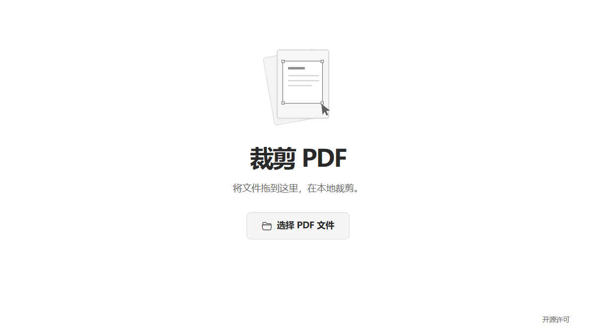

# PDF 页面裁剪工具

在 Chrome 或 Edge 的工具栏点一下扩展图标，就能打开 PDF、拖出选框，另存裁剪后的文件。也可以直接打开约 2.9 MiB 的单个 HTML。两种版本都能断网使用，文件在本机处理。



**裁剪改变的是显示范围，原始内容还在。** 例如，裁掉页脚后，恢复页面边界仍可能看到页脚里的文字。要永久删除姓名、手机号等信息，请使用 PDF 密文处理功能。

## 打开工具

**浏览器扩展。** 下载并解压扩展包，打开 `chrome://extensions` 或 `edge://extensions`，启用开发者模式，点击“加载已解压的扩展程序”，选中包含 `manifest.json` 的文件夹。把扩展固定到工具栏，下次点击图标即可打开。扩展无需读取其他网站的权限。[下载扩展包](dist/pdf-crop-extension.zip)

**单文件版。** 在 GitHub 文件页点击 **Download raw file**，用 Chrome 或 Edge 打开下载的 HTML。阅读和写入 PDF 用到的库、字体资源和字符映射都在这个文件里。[下载 HTML](dist/pdf-crop.html)

## 裁剪一份文档

拖入 PDF，在预览上框住要保留的区域。拖动框内可以平移选区，拖动边角可以调整大小。扫描件四周有白边时，可以先点“自动去白边”。工具根据当前页的预览像素查找内容边缘，留出约 2 mm 余量，最后由你确认选框。

需要每页裁掉相同宽度时，在“裁剪设置”里输入毫米数，再把选框应用到全部页面、奇偶页或指定范围，例如 `1, 3–5, 8`。对于混排的 A4 和 A3 页面，选择“保持相同毫米数”，两种纸都能从左边裁掉 10 mm。选择“保持相同比例”，则各自裁掉相同百分比的页宽。整次批量修改可以一步撤销。

## 导出如何保留原始画质

PDF.js 只渲染当前页供预览，画布长边为 1800 像素。导出时，程序把选框的两个对角点从预览坐标换算回 PDF 坐标，再用 pdf-lib 写入已调整页面的 `CropBox`。原有文字仍可选中，矢量图和嵌入图片无需重新采样。只有预览和自动识别白边用到这张画布。[裁剪与导出代码](app.js)

工具接受未加密的 PDF。修改过的文档会重新序列化，导出时需要在内存中处理整份文件。已签名文档的签名也可能失效。如果没有修改选框，导出直接复制输入文件。

## 构建和测试

构建使用 Python 3.9 或更高版本的标准库，从 npm 下载固定版本的 PDF.js 4.10.38 和 pdf-lib 1.17.1，并校验发布包的完整性摘要。在仓库根目录运行以下命令。

```sh
python build.py pdf-crop.html
python build.py --extension pdf-crop-extension
```

浏览器测试使用 Python 3.10 或更高版本，在 Chrome 中测试单文件版，在 Edge 的临时配置中加载实际扩展。测试会在脚本目录生成一份五页样本，覆盖不同纸张尺寸、四种旋转角度、已有裁剪框和非默认的 PDF 页面单位。通过界面导出后，逐页比较预期裁剪坐标、绘制指令、嵌入图片数据、文字和链接。[测试脚本](qa.py)

```sh
python -m pip install playwright reportlab pillow pypdf
python qa.py pdf-crop.html
python qa.py --extension pdf-crop-extension
```

两个版本的页面底部都附有 PDF.js、pdf-lib、Bootstrap Icons 及随附资源的许可。
